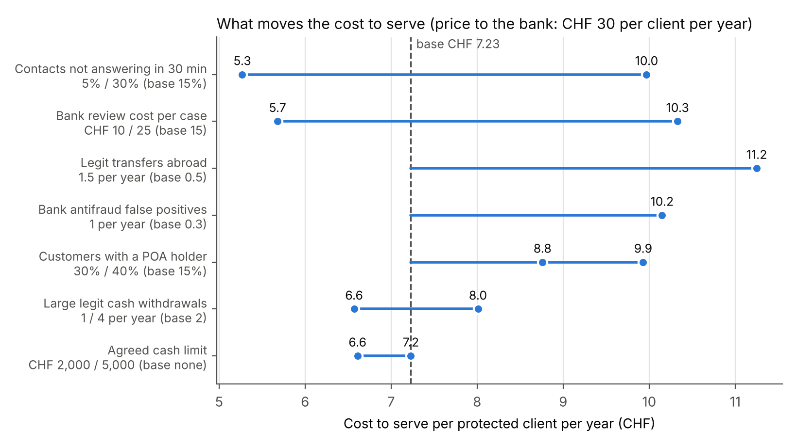

# Portfolio simulation · results

*Generated on 16.11.2026 with `python scripts/simula_portafoglio.py`. All customer data are synthetic. Threshold fixed at **0.50** (calibrated by Utente 1: `results/calibration_report.md`). The books are the same as the API's `/stats`, so report, demo and deck show the same numbers.*

## 1. Numbers for the deck (Utente 4)

| What to say | Number | v6 | Source in this report |
|---|---|---|---|
| Alerts per protected client per year | **1.5** | ~1.5 | §2 |
| Resolved by the trusted contact / escalated to the bank | **79% / 21%** | ~80% / ~20% | §2 |
| Cost to serve per client per year | **CHF 7.23** (range CHF 7.2–7.7) | CHF 7 | §2–3 |
| Bank's LTV/CAC, base scenario | **7.3×** | 7.4× | §5 |
| CAC payback, base scenario | **16 months** | 16 months | §5 |
| Fraud episodes stopped / fraud money protected | **89% / 96%** (synthetic data) | — | §2, §4 |

**Conclusion: the v6 numbers hold and the document does not need to change.** The simulated cost to serve (CHF 7.23, range CHF 7.23–7.70) is only CHF 0.23 above the CHF 7 used in v6, and LTV/CAC hardly moves. Say *"about CHF 7 per client per year, measured by simulating the whole process"*.

How to present them:
- **The bank pays for trust, not for the money it saves.** Money protected benefits the client and the family (v6), so it is not the argument for the price.
- **Detection is measured on synthetic data, where frauds are easier to spot than in reality.** Say *"to be confirmed in the pilot"*. Do not present 96% as a promise.
- **The cost to serve is uncertain, but never critical.** In every scenario tested it stays between CHF 5 and 11, against a price of CHF 30 (§3). The assumption to measure first in a pilot is the share of clients with a power of attorney: public sources already suggest it is higher than the 15% used here.

## 2. Base scenario vs the pitch (document v6)

| Indicator | Simulation | v6 assumption |
|---|---|---|
| Alerts per client per year | **1.48** | ~1.5 |
| Resolved by the trusted contact | **79%** | ~80% |
| Escalated to the bank | **21%** (conflict of interest: 7% of alerts) | ~20% |
| Bank cases per client per year | 0.31 | — |
| Cost to serve per client per year | **CHF 7.23** | CHF 7 |
| Fraud episodes caught | **89%** | — |
| Fraud money protected (stopped from the first pause on) | **96%** | — |

By threat (episodes caught and money protected):

| money protected · abuso_interno | episodes caught · abuso_interno | money protected · bonifico_estero | episodes caught · bonifico_estero | money protected · truffa_esterna | episodes caught · truffa_esterna |
|---|---|---|---|---|---|
| 95% | 96% | 100% | 100% | 94% | 83% |

## 3. Robustness and sensitivity

**Robustness.** The base scenario repeated on two other sets of simulated books (900 + 1,800 customers each):

| scenario | alerts/client/year | to the bank | cost to serve CHF | fraud episodes caught | fraud money protected |
|---|---|---|---|---|---|
| Base (books used by the API) | 1.48 | 21% | 7.23 | 89% | 96% |
| Base, book set 2 | 1.48 | 22% | 7.47 | 93% | 97% |
| Base, book set 3 | 1.58 | 22% | 7.70 | 89% | 96% |

Range: **1.48–1.58 alerts per client per year, 21%–22% to the bank, cost to serve CHF 7.23–7.70.**

**Sensitivity**, with the same threshold and one assumption changed at a time:

| scenario | alerts/client/year | to the bank | cost to serve CHF | fraud episodes caught | fraud money protected |
|---|---|---|---|---|---|
| Base | 1.48 | 21% | 7.23 | 89% | 96% |
| Large legit cash withdrawals: 1/year (base 2) | 1.34 | 20% | 6.57 | 89% | 96% |
| Large legit cash withdrawals: 4/year | 1.75 | 20% | 8.01 | 88% | 95% |
| Legit transfers abroad: 1.5/year (base 0.5) | 2.48 | 22% | 11.25 | — | — |
| Bank antifraud false positives: 1/year (base 0.3) | 2.19 | 22% | 10.15 | — | — |
| Contacts not answering in 30 min: 5% (base 15%) | 1.48 | 12% | 5.27 | — | — |
| Contacts not answering in 30 min: 30% | 1.48 | 34% | 9.97 | — | — |
| Customers with a POA holder: 30% (base 15%) | 1.53 | 27% | 8.76 | — | — |
| Customers with a POA holder: 40% | 1.53 | 32% | 9.93 | — | — |
| Bank review cost per case: CHF 10 (base 15) | 1.48 | 21% | 5.68 | — | — |
| Bank review cost per case: CHF 25 | 1.48 | 21% | 10.33 | — | — |

**Reading.** Two things drive the cost to serve:
- **How many cases go to the bank** (CHF 15 each, against CHF 0.50 for a notification to the contact):
  - contacts who do not answer: CHF 9.97 if 30% of them do not answer;
  - clients with a power of attorney: CHF 8.76 at 30% and CHF 9.93 at 40%. Public sources suggest 20%–40% (`calibration_report.md`), so this is the risk most likely to materialise.
- **How often legitimate clients do something unusual:** transfers abroad, or flags from the bank's antifraud. These are the largest single effects, but there are no public data on them. Only a pilot can measure them.

Even in the worst case tested (CHF 11.25) the cost to serve stays far below the price (CHF 30 per client per year).

## 4. Fraud amounts from the sources, and the cash-limit lever

| scenario | alerts/client/year | to the bank | cost to serve CHF | fraud episodes caught | fraud money protected |
|---|---|---|---|---|---|
| Base | 1.48 | 21% | 7.23 | 89% | 96% |
| Fraud amounts from the public sources | 1.48 | 21% | 7.23 | 97% | 99% |
| Agreed cash limit: CHF 2,000 | 1.48 | 21% | 7.23 | 89% | 96% |
| Agreed cash limit: CHF 5,000 | 1.35 | 20% | 6.61 | 88% | 95% |

- **Amounts from the public sources** (shock-call scams with a median of CHF 25,000; larger POA abuse): the engine stops 97% of the episodes instead of 89%. The base case uses smaller amounts on purpose, so the pitch figures are a **lower bound**.
- **Agreed cash limit** (optional lever): at sign-up the client agrees that their own cash withdrawals below a limit never cause a pause. Withdrawals by a POA holder and the bank's antifraud flags stay covered.
  - CHF 2,000: 1.48 alerts and CHF 7.23, with 89% of episodes caught.
  - CHF 5,000: 1.35 alerts and CHF 6.61, with 88% of episodes caught.

  The saving is small: at most CHF 0.62 per client per year. Clients' own cash withdrawals below CHF 2,000 almost never cause a pause anyway, while at CHF 5,000 some small scams get through. **We do not recommend it as the default.** Keep it as an option for clients who withdraw a lot of cash and find the pauses annoying.

## 5. Effect on the unit economics of a typical bank (v6, page 3)

Same adoption, price and CAC as v6; only the cost to serve changes (simulated: CHF 7.23; prudent scenario +CHF 1, as in v6).

| business scenario | contribution/client v6 | contribution/client simulated | LTV/CAC v6 | LTV/CAC simulated | CAC payback months v6 | CAC payback months simulated |
|---|---|---|---|---|---|---|
| prudente | 16.00 | 15.77 | 1.60 | 1.60 | 75.00 | 76.10 |
| base | 23.00 | 22.77 | 7.40 | 7.30 | 16.30 | 16.50 |
| ottimistico | 23.00 | 22.77 | 23.00 | 22.80 | 5.20 | 5.30 |

## 6. How to read these results

- **Scope.** Sentinel looks at cash at the counter, safe deposit box visits and transfers to new or foreign accounts (v6). Card payments are left to the bank's card antifraud, so they never raise a Sentinel alert.
- **Where alerts come from.** New payees and transfers abroad, rare safe deposit box visits, very large cash withdrawals, and the bank's own antifraud flags. Each is an assumption on behaviour that only a pilot with a bank can confirm.
- **What drives the cost to serve.** Cases escalated to the bank: contacts who do not answer in 30 minutes and conflicts of interest (the contact holds a power of attorney).
- **Detection is high on synthetic data.** Small scams (a few thousand francs) are the ones that slip through. With real, subtler fraud the rate will be lower.
- **What only a pilot can measure:** large legitimate counter withdrawals, response time of contacts, real share of POA holders. Sources and the fraud prevalence (1%) are discussed in `results/calibration_report.md`.

## Method

- **Threshold:** fixed at 0.50.
- **Operational load:** 3 books × 300 seniors at the real fraud prevalence of 1% (seeds 100–102).
- **Fraud stopped:** 6 books × 300 seniors with frauds oversampled to 30% (seeds 0–5).
- **Two years per customer:** year 1 teaches the engine their habits, year 2 is counted.
- **Routing:** every paused operation is routed with `workflow.destinazione_finale`, with 15% of contacts not answering within 30 minutes.
- **Service costs:** CHF 0.50 per notification, CHF 15 per bank review, CHF 2 platform cost per client per year.

These are the same books used by the API's `/stats` and by `notebooks/calibrazione.ipynb`.
